<h1 align="center">Crown of the Lamb</h1>

<p align="center">
  <a href="https://github.com/wielorzeczownik/crown-of-the-lamb/actions/workflows/release.yml"><picture><source media="(prefers-color-scheme: dark)" srcset="https://img.shields.io/github/actions/workflow/status/wielorzeczownik/crown-of-the-lamb/release.yml?branch=main&style=flat-square&labelColor=2d333b&color=3fb950"/><source media="(prefers-color-scheme: light)" srcset="https://img.shields.io/github/actions/workflow/status/wielorzeczownik/crown-of-the-lamb/release.yml?branch=main&style=flat-square&color=2ea043"/></picture></a> <a href="https://github.com/wielorzeczownik/crown-of-the-lamb/releases/latest"><picture><source media="(prefers-color-scheme: dark)" srcset="https://img.shields.io/github/v/release/wielorzeczownik/crown-of-the-lamb?style=flat-square&labelColor=2d333b&color=3fb950"/><source media="(prefers-color-scheme: light)" srcset="https://img.shields.io/github/v/release/wielorzeczownik/crown-of-the-lamb?style=flat-square&color=2ea043"/></picture></a> <a href="https://github.com/wielorzeczownik/crown-of-the-lamb/blob/main/LICENSE"><picture><source media="(prefers-color-scheme: dark)" srcset="https://img.shields.io/badge/License-MIT-3fb950?style=flat-square&labelColor=2d333b"/><source media="(prefers-color-scheme: light)" srcset="https://img.shields.io/badge/License-MIT-2ea043?style=flat-square"/></picture></a>
  <br/>
    
</p>

<p align="center">
  <picture><source media="(prefers-color-scheme: dark)" srcset="https://raw.githubusercontent.com/wielorzeczownik/crown-of-the-lamb/main/assets/logo-dark.svg"/><source media="(prefers-color-scheme: light)" srcset="https://raw.githubusercontent.com/wielorzeczownik/crown-of-the-lamb/main/assets/logo.svg"/></picture>
</p>

<p align="center">🇬🇧 English | 🇵🇱 <a href="README.pl.md">Polski</a></p>

ESP32 firmware for a Cult of the Lamb crown prop. The eye is a round GC9A01 display that blinks, looks around and reacts to sound picked up by two microphones.

Settings are changed from a phone through a WiFi portal hosted by the crown. Firmware updates go through the same portal.

<p align="center">
  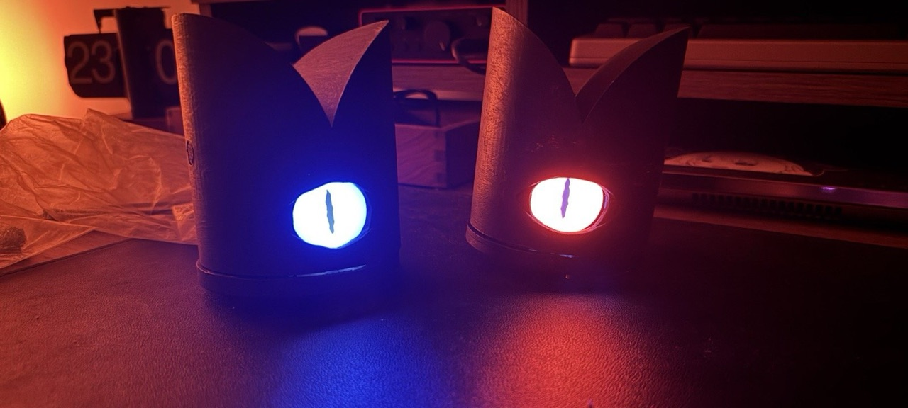
</p>

## Bill of materials

### 3D-printed enclosure

The shell is [Red Crown (Cult of the Lamb)](https://www.printables.com/model/326078-red-crown-cult-of-the-lamb/files) by [ShinpiMakes](https://www.printables.com/@ShinpiMakes_277232) from Printables, the Full Shelled Cross Mount variant. Changes made to fit the electronics:

- a hole for the eye (the display window),
- microphone holes on both sides,
- openings for 2 USB-C ports (charger and boost module) and the power switch.

Print it at 120% so everything fits inside. Scaling depends on your printer and slicer, so go by the real size: the finished print should be about 11.5 cm tall, from the lowest to the highest point.

### Parts

| Part                                                | Role                                                                     | Source                                                                                                                      |
| --------------------------------------------------- | ------------------------------------------------------------------------ | --------------------------------------------------------------------------------------------------------------------------- |
| ESP32 DevKitC-32D                                   | main MCU                                                                 | [AliExpress](https://pl.aliexpress.com/item/1005007963451549.html)                                                          |
| GC9A01 240×240 round display                        | the eye                                                                  | [AliExpress](https://pl.aliexpress.com/item/1005004482028005.html)                                                          |
| 2× MAX9814 microphone module                        | sound direction                                                          | [AliExpress](https://pl.aliexpress.com/item/1005006109706636.html)                                                          |
| USB-C charging module                               | Li-ion charging                                                          | [AliExpress](https://pl.aliexpress.com/item/1005009438702687.html)                                                          |
| MT3608 boost converter (USB-C)                      | steps the battery up to 5 V                                              | [AliExpress](https://pl.aliexpress.com/item/1005011548818999.html)                                                          |
| 18650 cell                                          | battery                                                                  | [AliExpress](https://pl.aliexpress.com/item/1005011665515612.html)                                                          |
| 18650 holder                                        | battery mount                                                            | [AliExpress](https://pl.aliexpress.com/item/1005005084346241.html)                                                          |
| Power switch                                        | cuts the battery circuit                                                 | [AliExpress](https://pl.aliexpress.com/item/4000681145062.html)                                                             |
| Jumper / Dupont wires                               | wiring                                                                   | [AliExpress](https://pl.aliexpress.com/item/1005006205169394.html)                                                          |
| 2× USB-C extension cable (short, e.g. UGREEN 0.5 m) | brings the ESP32 and charging ports out to the shell, any short one does | [UGREEN](https://www.ugreen.pl/pl/products/kable/usb-c/przedluzajacy-kabel-ugreen-usb-c-0-5m-3-1-4k-60w-czarny-ed008-60664) |
| Small heatsink set                                  | cools the ESP32 and keeps the warm chip off the plastic                  | [AliExpress](https://pl.aliexpress.com/item/4000266052801.html)                                                             |
| Standoff / spacer set                               | holds the display at the right depth                                     | [AliExpress](https://pl.aliexpress.com/item/1005006270641755.html)                                                          |

> [!NOTE]
> The parts cost about 150 PLN (~€35) at the time of building, prices have gone up since. AliExpress
> links die often. If one does, search by the part name, any equivalent module
> works.

## Wiring

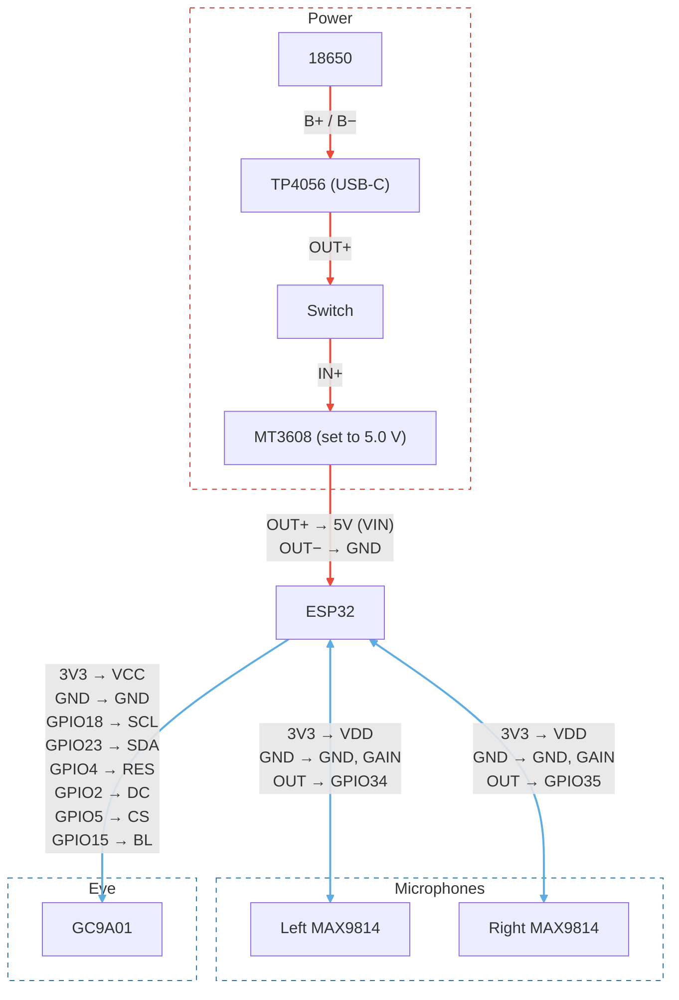

### Signal

| GC9A01     | ESP32              |
| ---------- | ------------------ |
| VCC        | 3V3                |
| GND        | GND                |
| SCL / SCK  | GPIO18 (SPI CLK)   |
| SDA / MOSI | GPIO23 (SPI MOSI)  |
| RES        | GPIO4              |
| DC         | GPIO2              |
| CS         | GPIO5              |
| BL         | GPIO15 (backlight) |

| MAX9814 | Left              | Right             |
| ------- | ----------------- | ----------------- |
| VDD     | 3V3               | 3V3               |
| GND     | GND               | GND               |
| OUT     | GPIO34 (ADC1_CH6) | GPIO35 (ADC1_CH7) |
| GAIN    | GND (60 dB)       | GND (60 dB)       |

Put the microphones on opposite sides of the crown. The direction comes from the level difference between them, so they need to be apart. The firmware sets the ADC to 11 dB attenuation, nothing to do there.

### Power

- Set the MT3608 to 5.0 V before you connect the ESP32.
- All the − and GND lines share a common ground.
- The display and both mics run from the ESP32's onboard 3.3 V regulator.
- Get a TP4056 module with protection (the one with 6 pads: IN±, B±, OUT±).
- With USB-C plugged in, the TP4056 charges the cell and powers the crown at the same time. Unplugged, the switch cuts the battery off completely.

> [!TIP]
> For a stable image, add some capacitors near the power pins: about 10 µF +
> 100 nF across the display VCC/GND and on the ESP32 3V3, plus 220-470 µF on
> the MT3608 output.

## Assembly

It's a tight fit. A few notes:

- Split the bottom in the slicer. Printed in one piece, the bottom has to be cut open and carved out afterwards to get the electronics in.
- Push everything into the corners. Battery and ESP32 go in first, the USB-C extensions and the display last.

<div align="center">
<table>
<tr>
<td align="center" width="25%">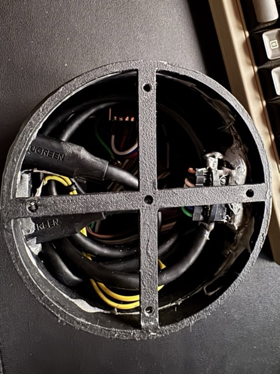<br/><sub><b>Base wiring</b><br/>cables & connectors packed in</sub></td>
<td align="center" width="25%">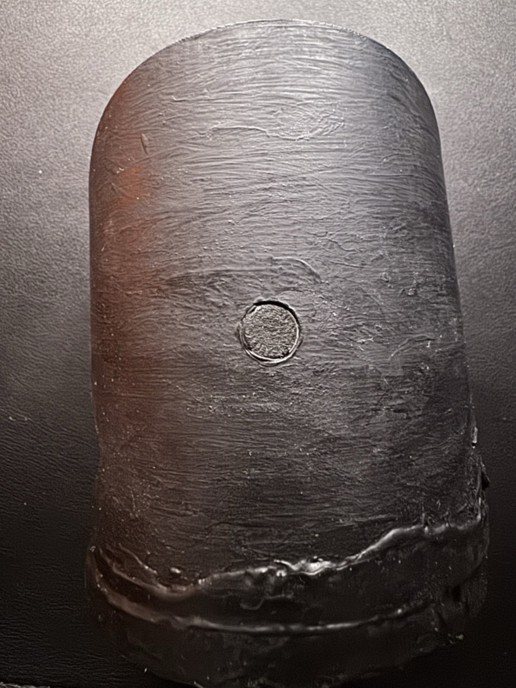<br/><sub><b>Rear</b><br/>sealed shell, mic port</sub></td>
<td align="center" width="25%">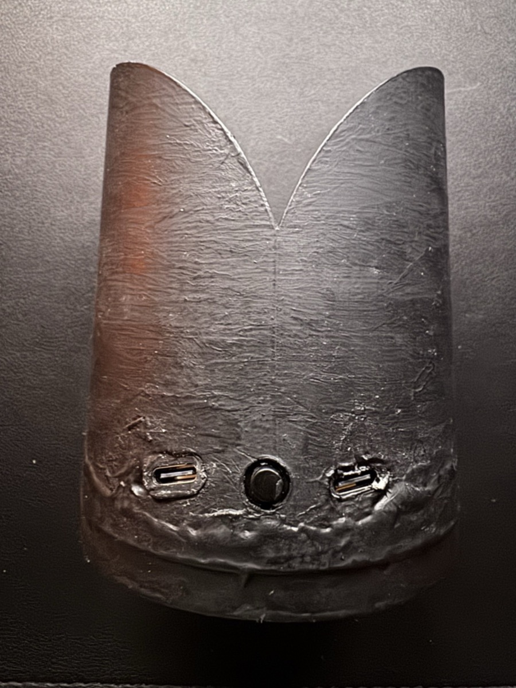<br/><sub><b>Ports</b><br/>dual USB-C & power button</sub></td>
<td align="center" width="25%">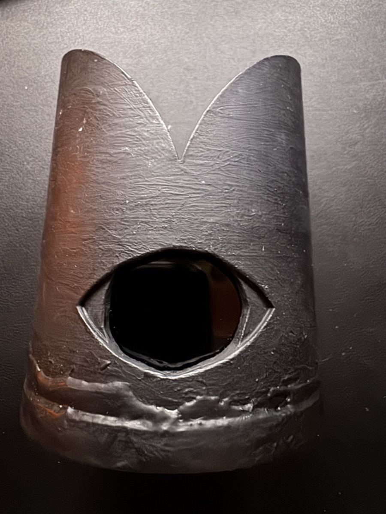<br/><sub><b>Front</b><br/>eye-socket cutout</sub></td>
</tr>
</table>
</div>

## Flashing

Prebuilt firmware is on [GitHub Releases](https://github.com/wielorzeczownik/crown-of-the-lamb/releases/latest). There are two files:

- **[crown-of-the-lamb.bin](https://github.com/wielorzeczownik/crown-of-the-lamb/releases/latest/download/crown-of-the-lamb.bin)**: the full image (bootloader, partition table and app), flashed over USB at `0x0`.
- **[crown-of-the-lamb-ota.bin](https://github.com/wielorzeczownik/crown-of-the-lamb/releases/latest/download/crown-of-the-lamb-ota.bin)**: just the app, for updating over WiFi from the portal.

The first flash goes over USB:

```bash
espflash write-bin 0x0 crown-of-the-lamb.bin
# or with esptool:
esptool.py --chip esp32 write_flash 0x0 crown-of-the-lamb.bin
```

After that you don't need the cable anymore. Open the portal and upload `crown-of-the-lamb-ota.bin` in the OTA tab.

## Configuration

When it boots, the crown starts its own WiFi network. Connect from a phone or laptop and the portal should open by itself. If it doesn't, go to `192.168.4.1`.

<div align="center">
<table>
<tr>
<td align="center" width="20%" valign="top">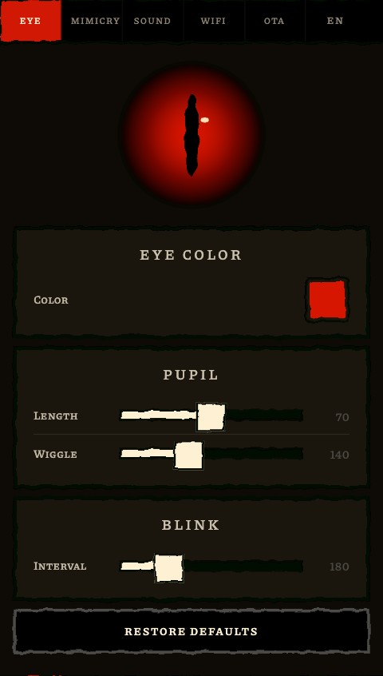<br/><sub><b>Eye</b><br/>colour, pupil & blink</sub></td>
<td align="center" width="20%" valign="top">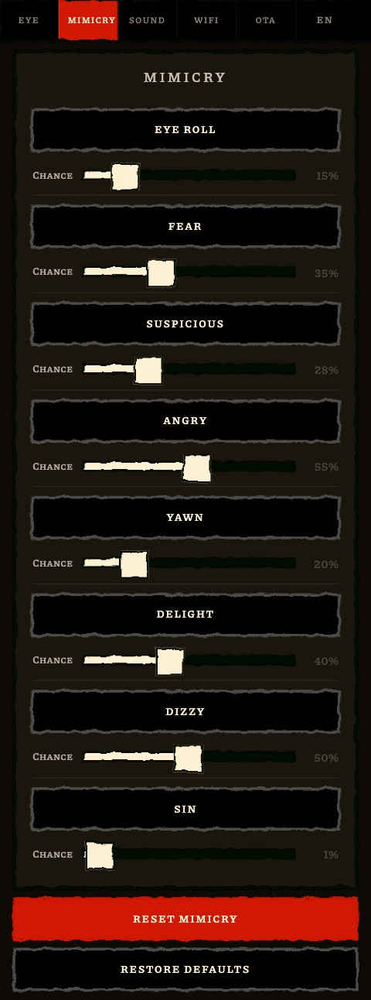<br/><sub><b>Mimicry</b><br/>expression chances</sub></td>
<td align="center" width="20%" valign="top">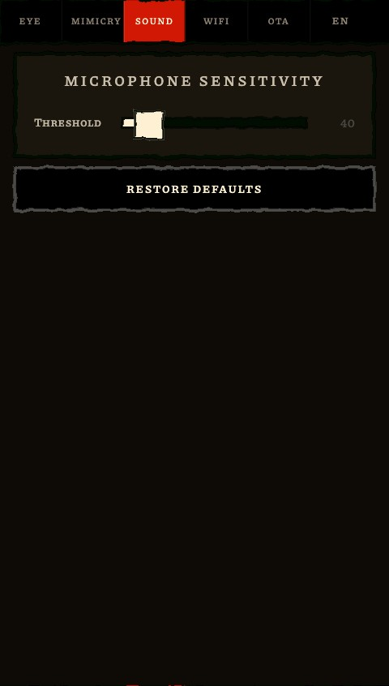<br/><sub><b>Sound</b><br/>mic sensitivity</sub></td>
<td align="center" width="20%" valign="top">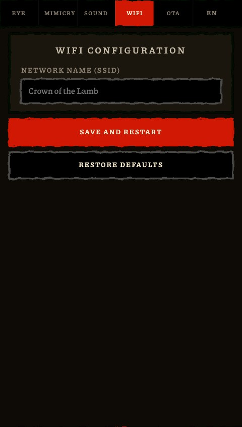<br/><sub><b>WiFi</b><br/>SSID setup</sub></td>
<td align="center" width="20%" valign="top">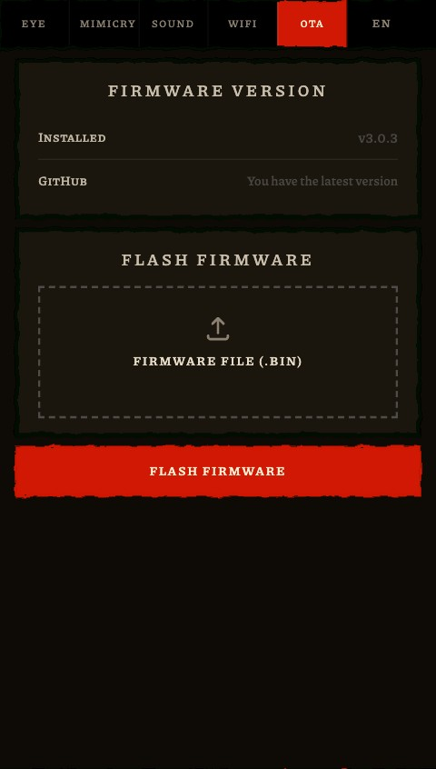<br/><sub><b>OTA</b><br/>firmware updates</sub></td>
</tr>
</table>
</div>

Every setting is changed live and saved to flash, so it survives a restart. The firmware clamps values to the allowed range.

<details>
<summary>All settings</summary>

| Setting             | Default             | Range   | Meaning                                                                               |
| ------------------- | ------------------- | ------- | ------------------------------------------------------------------------------------- |
| Eye colour (red)    | `26`                | 0-31    | Rgb565 red channel, 5-bit                                                             |
| Eye colour (green)  | `5`                 | 0-63    | Rgb565 green channel, 6-bit                                                           |
| Eye colour (blue)   | `0`                 | 0-31    | Rgb565 blue channel, 5-bit                                                            |
| Pupil length        | `70`                | 20-120  | Half the height of the pupil slit, in pixels                                          |
| Wiggle amplitude    | `140`               | 0-400   | How much the gaze drifts at rest, in hundredths of a pixel                            |
| Blink interval      | `180`               | 60-600  | Minimum frames between blinks                                                         |
| Sound threshold     | `40`                | 10-400  | How loud a mic has to get to count as a sound, in ADC counts (a quiet room is ~10-15) |
| `Sin` chance        | `1`                 | 0-100 % | Rolled on each blink, `0` turns it off                                                |
| `EyeRoll` chance    | `15`                | 0-100 % | Rolled each time the sound direction changes                                          |
| `Startled` chance   | `35`                | 0-100 % | Rolled each time the sound direction changes                                          |
| `Suspicious` chance | `28`                | 0-100 % | Rolled each time the sound direction changes                                          |
| `Angry` chance      | `55`                | 0-100 % | Rolled each time the sound direction changes                                          |
| `Yawn` chance       | `20`                | 0-100 % | Rolled each time the eye looks around while drowsy                                    |
| `Delight` chance    | `40`                | 0-100 % | Rolled when a sound comes in while the eye is drowsy                                  |
| `Dizzy` chance      | `50`                | 0-100 % | Rolled when `Angry` doesn't fire after quick changes of sound direction               |
| Access point SSID   | `Crown of the Lamb` | ≤ 32 B  | Name of the crown's WiFi network. Longer names are rejected                           |

</details>

The log level is set at build time, not in the portal: `DEFMT_LOG` (default `info`). It can be set per module, e.g. `DEFMT_LOG=info,cotl::sound=debug`.

## Building from source

You need the Xtensa `esp` Rust toolchain.

```bash
# One-time toolchain setup
cargo install espup espflash
espup install --targets esp32
source "$HOME/export-esp.sh"   # add this to your shell profile

# Build, flash and open the serial monitor
cargo run --release
```

> [!IMPORTANT]
> Always build with `--release`.

## Disclaimer

A hobby project. Not official and not affiliated with Cult of the Lamb or Massive Monster.
