<h1 align="center">Crown of the Lamb</h1>

<p align="center">
  <a href="https://github.com/wielorzeczownik/crown-of-the-lamb/actions/workflows/release.yml"><picture><source media="(prefers-color-scheme: dark)" srcset="https://img.shields.io/github/actions/workflow/status/wielorzeczownik/crown-of-the-lamb/release.yml?branch=main&style=flat-square&labelColor=2d333b&color=3fb950"/><source media="(prefers-color-scheme: light)" srcset="https://img.shields.io/github/actions/workflow/status/wielorzeczownik/crown-of-the-lamb/release.yml?branch=main&style=flat-square&color=2ea043"/></picture></a> <a href="https://github.com/wielorzeczownik/crown-of-the-lamb/releases/latest"><picture><source media="(prefers-color-scheme: dark)" srcset="https://img.shields.io/github/v/release/wielorzeczownik/crown-of-the-lamb?style=flat-square&labelColor=2d333b&color=3fb950"/><source media="(prefers-color-scheme: light)" srcset="https://img.shields.io/github/v/release/wielorzeczownik/crown-of-the-lamb?style=flat-square&color=2ea043"/></picture></a> <a href="https://github.com/wielorzeczownik/crown-of-the-lamb/blob/main/LICENSE"><picture><source media="(prefers-color-scheme: dark)" srcset="https://img.shields.io/badge/License-MIT-3fb950?style=flat-square&labelColor=2d333b"/><source media="(prefers-color-scheme: light)" srcset="https://img.shields.io/badge/License-MIT-2ea043?style=flat-square"/></picture></a>
  <br/>
    
</p>

<p align="center">
  
</p>

<p align="center">🇬🇧 <a href="README.md">English</a> | 🇵🇱 Polski</p>

Firmware ESP32 do rekwizytu korony z Cult of the Lamb. Oko to okrągły wyświetlacz GC9A01, który mruga, rozgląda się i reaguje na dźwięk z dwóch mikrofonów.

Ustawienia zmienia się z telefonu przez panel WiFi wystawiany przez koronę. Przez ten sam panel wgrywa się aktualizacje firmware.

<p align="center">
  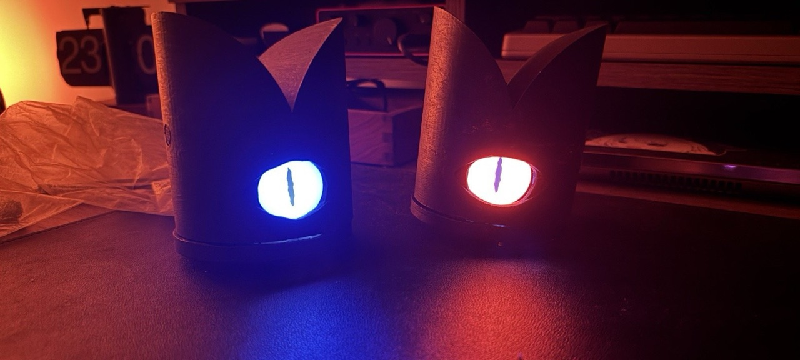
</p>

## Lista części

### Obudowa (druk 3D)

Skorupa to [Red Crown (Cult of the Lamb)](https://www.printables.com/model/326078-red-crown-cult-of-the-lamb/files) od [ShinpiMakes](https://www.printables.com/@ShinpiMakes_277232) z Printables, wariant Full Shelled Cross Mount. Zmiany pod elektronikę:

- otwór na oko (okno wyświetlacza),
- otwory na mikrofony po obu bokach,
- wycięcia na 2 porty USB-C (ładowarka i przetwornica) oraz włącznik.

Drukuj w skali 120%, żeby wszystko weszło do środka. Skalowanie zależy od drukarki i slicera, więc kieruj się rzeczywistym rozmiarem: gotowy wydruk powinien mieć około 11,5 cm wysokości, od najniższego do najwyższego punktu.

### Części

| Część                                           | Rola                                                                 | Źródło                                                                                                                      |
| ----------------------------------------------- | -------------------------------------------------------------------- | --------------------------------------------------------------------------------------------------------------------------- |
| ESP32 DevKitC-32D                               | główny MCU                                                           | [AliExpress](https://pl.aliexpress.com/item/1005007963451549.html)                                                          |
| Wyświetlacz GC9A01 240×240                      | oko                                                                  | [AliExpress](https://pl.aliexpress.com/item/1005004482028005.html)                                                          |
| 2× moduł mikrofonu MAX9814                      | kierunek dźwięku                                                     | [AliExpress](https://pl.aliexpress.com/item/1005006109706636.html)                                                          |
| Moduł ładowania USB-C                           | ładowanie ogniwa Li-ion                                              | [AliExpress](https://pl.aliexpress.com/item/1005009438702687.html)                                                          |
| Przetwornica MT3608 (USB-C)                     | podbija napięcie baterii do 5 V                                      | [AliExpress](https://pl.aliexpress.com/item/1005011548818999.html)                                                          |
| Ogniwo 18650                                    | bateria                                                              | [AliExpress](https://pl.aliexpress.com/item/1005011665515612.html)                                                          |
| Koszyk 18650                                    | mocowanie ogniwa                                                     | [AliExpress](https://pl.aliexpress.com/item/1005005084346241.html)                                                          |
| Włącznik                                        | odcina baterię                                                       | [AliExpress](https://pl.aliexpress.com/item/4000681145062.html)                                                             |
| Przewody jumper / Dupont                        | okablowanie                                                          | [AliExpress](https://pl.aliexpress.com/item/1005006205169394.html)                                                          |
| 2× przedłużacz USB-C (krótki, np. UGREEN 0,5 m) | wyprowadza porty ESP32 i ładowania na obudowę, każdy krótki się nada | [UGREEN](https://www.ugreen.pl/pl/products/kable/usb-c/przedluzajacy-kabel-ugreen-usb-c-0-5m-3-1-4k-60w-czarny-ed008-60664) |
| Zestaw małych radiatorów                        | chłodzi ESP32 i trzyma ciepły chip z dala od plastiku                | [AliExpress](https://pl.aliexpress.com/item/4000266052801.html)                                                             |
| Zestaw dystansów                                | trzyma wyświetlacz na właściwej głębokości                           | [AliExpress](https://pl.aliexpress.com/item/1005006270641755.html)                                                          |

> [!NOTE]
> Części kosztowały około 150 zł w momencie budowy, od tamtej pory ceny poszły w górę. Linki
> do AliExpress często znikają. Jak któryś nie działa, szukaj po nazwie części,
> każdy odpowiednik się nada.

## Podłączenie

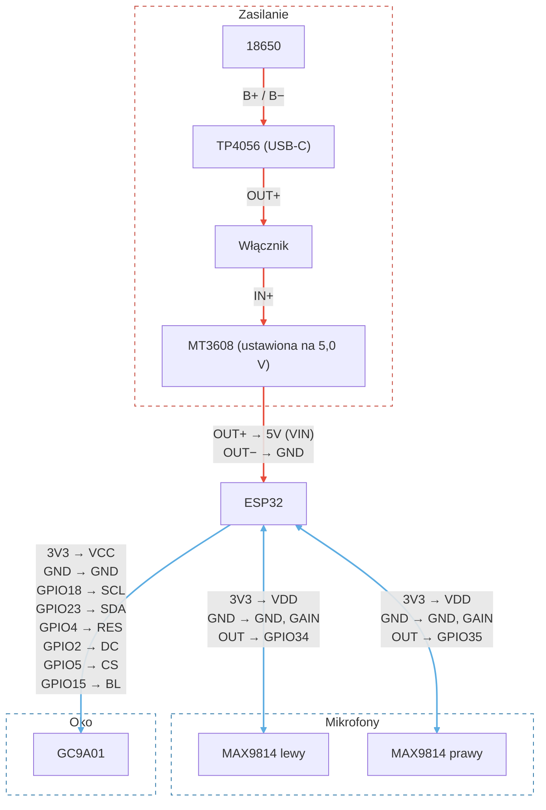

### Sygnał

| GC9A01     | ESP32                  |
| ---------- | ---------------------- |
| VCC        | 3V3                    |
| GND        | GND                    |
| SCL / SCK  | GPIO18 (SPI CLK)       |
| SDA / MOSI | GPIO23 (SPI MOSI)      |
| RES        | GPIO4                  |
| DC         | GPIO2                  |
| CS         | GPIO5                  |
| BL         | GPIO15 (podświetlenie) |

| MAX9814 | Lewy              | Prawy             |
| ------- | ----------------- | ----------------- |
| VDD     | 3V3               | 3V3               |
| GND     | GND               | GND               |
| OUT     | GPIO34 (ADC1_CH6) | GPIO35 (ADC1_CH7) |
| GAIN    | GND (60 dB)       | GND (60 dB)       |

Mikrofony daj po przeciwnych stronach korony. Kierunek wychodzi z różnicy głośności między nimi, więc muszą być od siebie oddalone. Atenuację ADC 11 dB ustawia firmware, nic tu nie trzeba robić.

### Zasilanie

- Ustaw MT3608 na 5,0 V, zanim podłączysz ESP32.
- Wszystkie − i GND idą do wspólnej masy.
- Wyświetlacz i oba mikrofony zasila wbudowany regulator 3,3 V w ESP32.
- Weź moduł TP4056 z ochroną (ten z 6 padami: IN±, B±, OUT±).
- Z podpiętym USB-C TP4056 ładuje ogniwo i jednocześnie zasila koronę. Po odpięciu włącznik całkowicie odcina baterię.

> [!TIP]
> Dla stabilnego obrazu dodaj kondensatory przy pinach zasilania: około
> 10 µF + 100 nF na VCC/GND wyświetlacza i na 3V3 ESP32, do tego 220-470 µF na
> wyjściu MT3608.

## Montaż

Wszystko wchodzi na styk. Kilka uwag:

- Podziel dół w slicerze. Przy wydruku w całości dół trzeba potem rozciąć i wydrążyć, żeby zmieścić elektronikę.
- Upychaj wszystko w rogi. Najpierw bateria i ESP32, na końcu przedłużacze USB-C i wyświetlacz.

<div align="center">
<table>
<tr>
<td align="center" width="25%">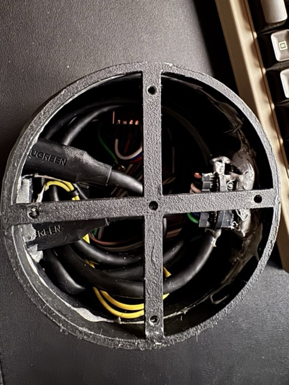<br/><sub><b>Podstawa</b><br/>kable i złącza upchane w środku</sub></td>
<td align="center" width="25%">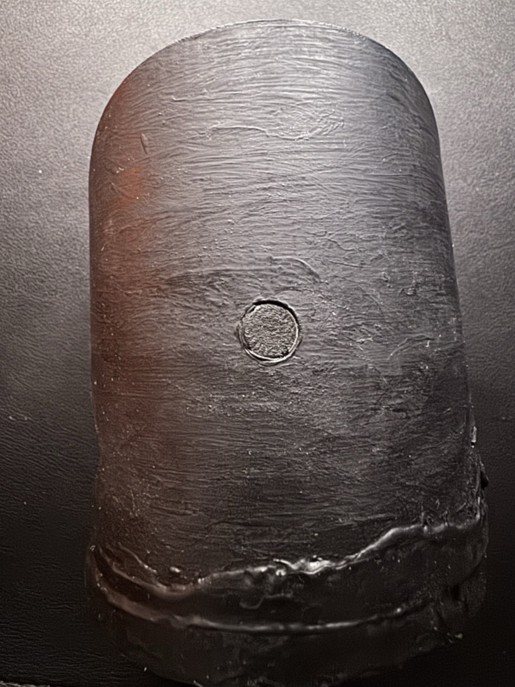<br/><sub><b>Tył</b><br/>zaklejona skorupa, otwór mikrofonu</sub></td>
<td align="center" width="25%">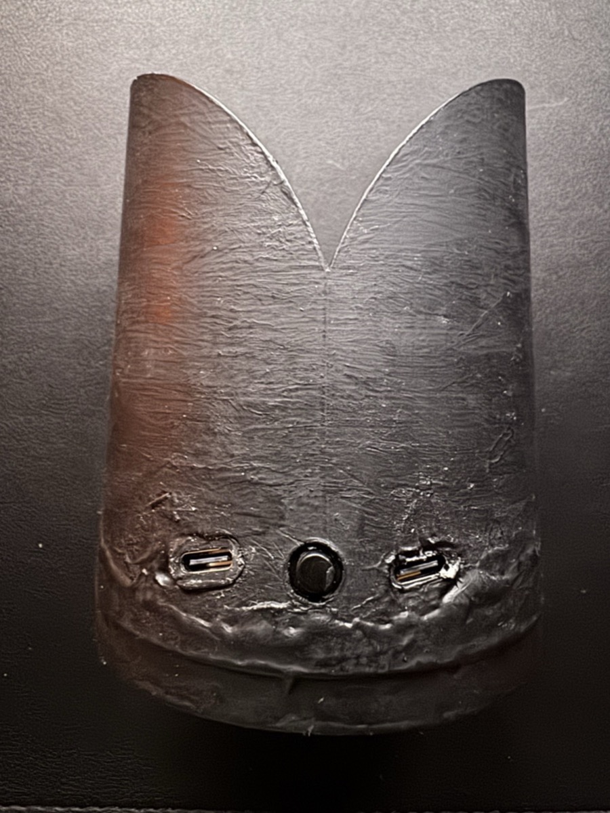<br/><sub><b>Porty</b><br/>dwa USB-C i przycisk zasilania</sub></td>
<td align="center" width="25%">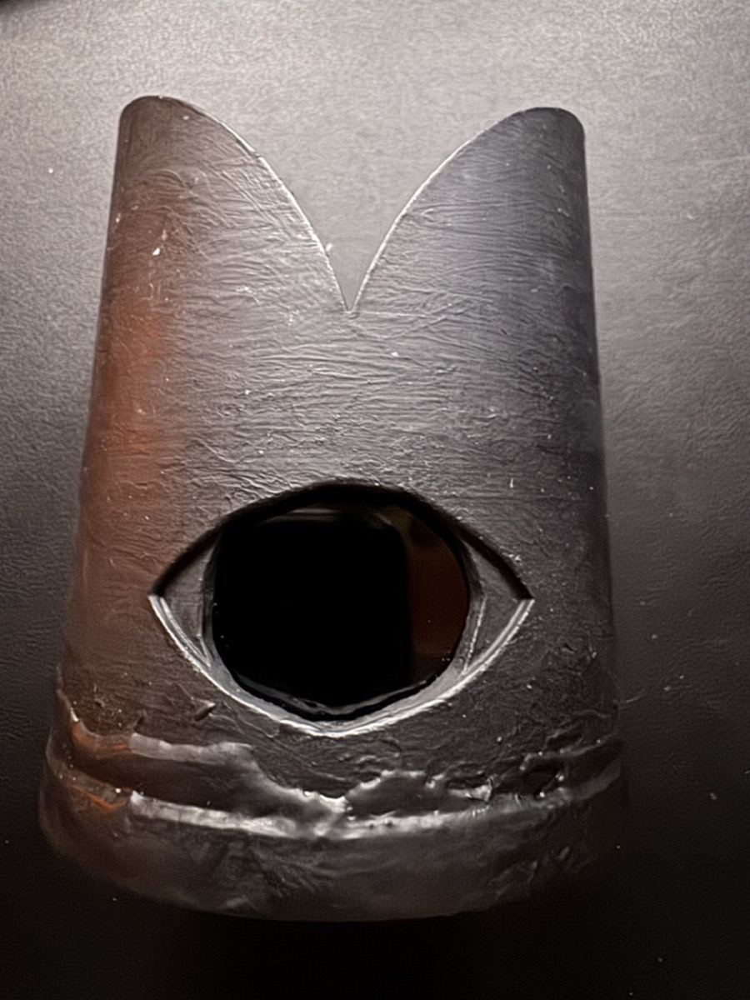<br/><sub><b>Przód</b><br/>wycięcie na oko</sub></td>
</tr>
</table>
</div>

## Wgrywanie

Gotowy firmware jest w [GitHub Releases](https://github.com/wielorzeczownik/crown-of-the-lamb/releases/latest). Są tam dwa pliki:

- **[crown-of-the-lamb.bin](https://github.com/wielorzeczownik/crown-of-the-lamb/releases/latest/download/crown-of-the-lamb.bin)**: pełny obraz (bootloader, tablica partycji i aplikacja), wgrywany kablem na `0x0`.
- **[crown-of-the-lamb-ota.bin](https://github.com/wielorzeczownik/crown-of-the-lamb/releases/latest/download/crown-of-the-lamb-ota.bin)**: sama aplikacja, do aktualizacji przez WiFi z panelu.

Za pierwszym razem wgrywasz kablem:

```bash
espflash write-bin 0x0 crown-of-the-lamb.bin
# albo esptool:
esptool.py --chip esp32 write_flash 0x0 crown-of-the-lamb.bin
```

Potem kabel nie jest już potrzebny. Otwórz panel i wgraj `crown-of-the-lamb-ota.bin` w zakładce OTA.

## Konfiguracja

Po starcie korona wystawia własną sieć WiFi. Połącz się telefonem albo laptopem, a panel powinien otworzyć się sam. Jeśli nie, wejdź na `192.168.4.1`.

<div align="center">
<table>
<tr>
<td align="center" width="20%" valign="top">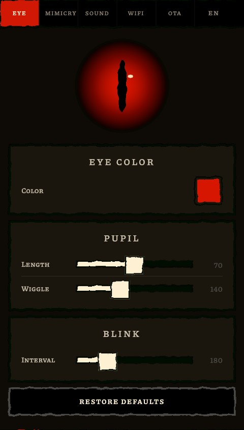<br/><sub><b>Oko</b><br/>kolor, źrenica i mruganie</sub></td>
<td align="center" width="20%" valign="top">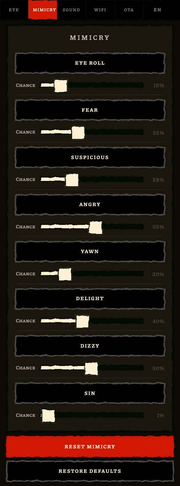<br/><sub><b>Miny</b><br/>szanse na miny</sub></td>
<td align="center" width="20%" valign="top">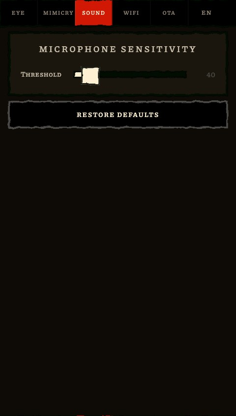<br/><sub><b>Dźwięk</b><br/>czułość mikrofonu</sub></td>
<td align="center" width="20%" valign="top">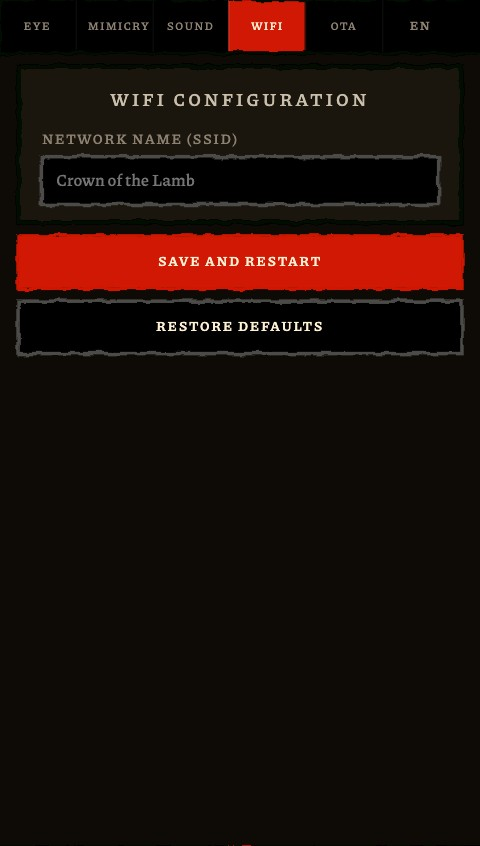<br/><sub><b>WiFi</b><br/>konfiguracja SSID</sub></td>
<td align="center" width="20%" valign="top">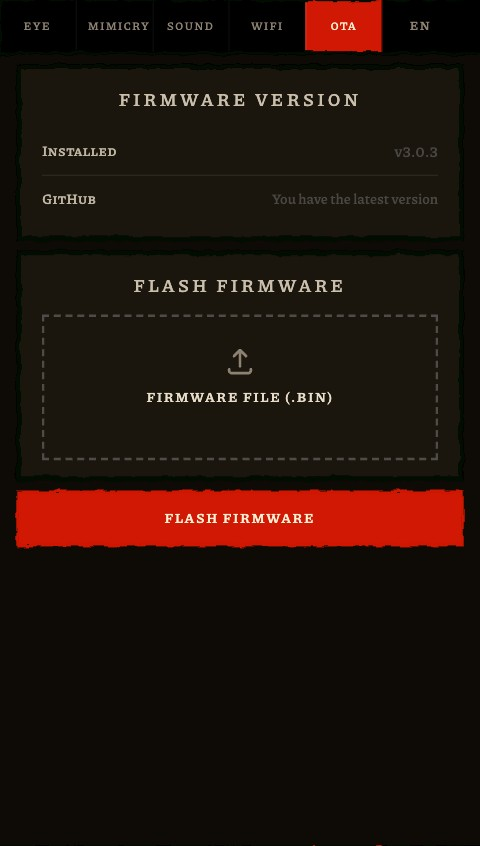<br/><sub><b>OTA</b><br/>aktualizacje firmware</sub></td>
</tr>
</table>
</div>

Każde ustawienie zmienia się na żywo i zapisuje we flashu, więc zostaje po restarcie. Firmware przycina wartości do dozwolonego zakresu.

<details>
<summary>Wszystkie ustawienia</summary>

| Ustawienie                | Domyślnie           | Zakres  | Znaczenie                                                                                               |
| ------------------------- | ------------------- | ------- | ------------------------------------------------------------------------------------------------------- |
| Kolor oka (czerwony)      | `26`                | 0-31    | Kanał czerwony Rgb565, 5 bitów                                                                          |
| Kolor oka (zielony)       | `5`                 | 0-63    | Kanał zielony Rgb565, 6 bitów                                                                           |
| Kolor oka (niebieski)     | `0`                 | 0-31    | Kanał niebieski Rgb565, 5 bitów                                                                         |
| Długość źrenicy           | `70`                | 20-120  | Połowa wysokości szpary źrenicy, w pikselach                                                            |
| Amplituda drgania         | `140`               | 0-400   | Jak bardzo wzrok dryfuje w spoczynku, w setnych piksela                                                 |
| Interwał mrugania         | `180`               | 60-600  | Minimalna liczba klatek między mrugnięciami                                                             |
| Próg dźwięku              | `40`                | 10-400  | Jak głośno musi być w mikrofonie, żeby uznać to za dźwięk, w jednostkach ADC (cichy pokój to ok. 10-15) |
| Szansa na `Grzech`        | `1`                 | 0-100 % | Losowana przy każdym mrugnięciu, `0` wyłącza                                                            |
| Szansa na `Zażenowanie`   | `15`                | 0-100 % | Losowana przy każdej zmianie kierunku dźwięku                                                           |
| Szansa na `Strach`        | `35`                | 0-100 % | Losowana przy każdej zmianie kierunku dźwięku                                                           |
| Szansa na `Podejrzliwość` | `28`                | 0-100 % | Losowana przy każdej zmianie kierunku dźwięku                                                           |
| Szansa na `Złość`         | `55`                | 0-100 % | Losowana przy każdej zmianie kierunku dźwięku                                                           |
| Szansa na `Ziewanie`      | `20`                | 0-100 % | Losowana przy każdym rozejrzeniu się, gdy oko jest senne                                                |
| Szansa na `Zachwyt`       | `40`                | 0-100 % | Losowana, gdy dźwięk pojawi się, kiedy oko jest senne                                                   |
| Szansa na `Oszołomienie`  | `50`                | 0-100 % | Losowana, gdy po szybkich zmianach kierunku dźwięku nie wypadnie `Złość`                                |
| SSID punktu dostępowego   | `Crown of the Lamb` | ≤ 32 B  | Nazwa sieci WiFi korony. Dłuższa nazwa jest odrzucana                                                   |

</details>

Poziom logów ustawia się przy budowaniu, nie w panelu: `DEFMT_LOG` (domyślnie `info`). Można go ustawić per moduł, np. `DEFMT_LOG=info,cotl::sound=debug`.

## Budowanie ze źródeł

Potrzebujesz toolchaina Rust dla Xtensa (`esp`).

```bash
# Jednorazowa konfiguracja toolchaina
cargo install espup espflash
espup install --targets esp32
source "$HOME/export-esp.sh"   # dodaj do profilu powłoki

# Zbuduj, wgraj i otwórz monitor portu szeregowego
cargo run --release
```

> [!IMPORTANT]
> Zawsze buduj z `--release`.

## Zastrzeżenie

Projekt hobbystyczny. Nieoficjalny i niezwiązany z Cult of the Lamb ani Massive Monster.
